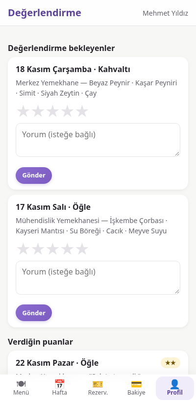
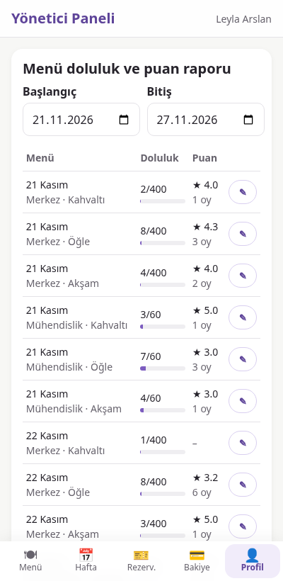
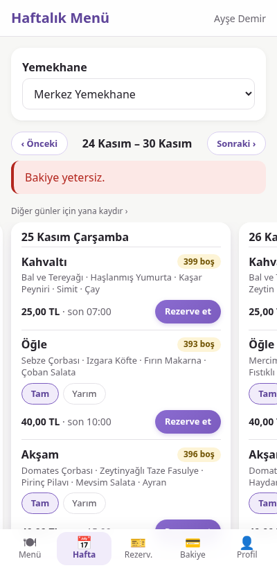
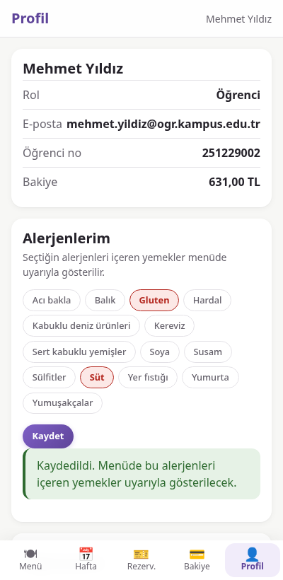
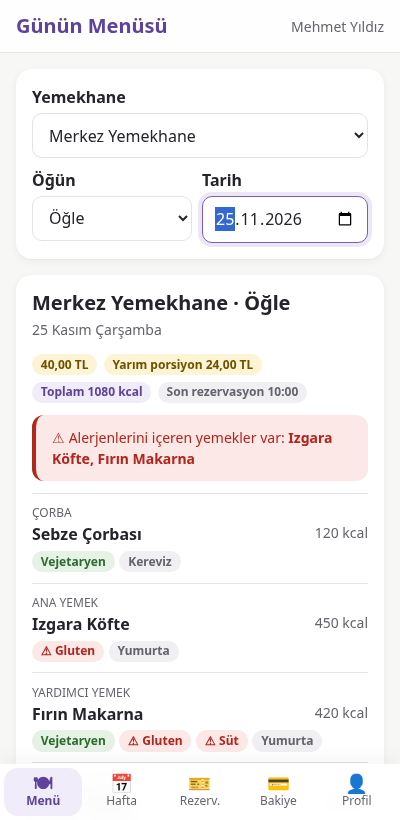
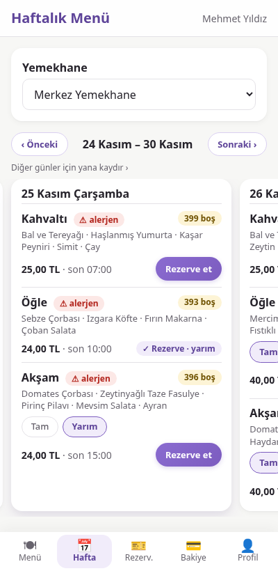

# Seçtiğim yol: Web API + arayüz

Uygulamayı Web API olarak yazdım. Sunucu tarafı Node.js ve Express ile yazıldı, sadece JSON
döndürüyor. Arayüz düz HTML, CSS ve JavaScript; `frontend` container'ındaki Apache sunuyor ve
veriyi `fetch` ile `/api/...` adreslerinden alıyor. Apache `-D WEBAPI` modunda çalışıyor,
`/api/` ile başlayan istekleri `uygulama` servisine yönlendiriyor.

Depo: <https://github.com/ardaky/yemekhane-otomasyonu>. Bütün komut çıktıları
`rapor/kanitlar/` klasöründe.

# Aşama 1 · Altyapı

Başlangıç paketini `docker compose up -d` ile çalıştırdım.

```text
$ docker compose ps -a
NAME                        SERVICE         STATUS
yemekhane-frontend-1        frontend        Up About a minute (healthy)
yemekhane-mysql-primary-1   mysql-primary   Up About a minute (healthy)
yemekhane-mysql-replica-1   mysql-replica   Up About a minute (healthy)
yemekhane-redis-1           redis           Up About a minute (healthy)
yemekhane-replica-setup-1   replica-setup   Exited (0) 23 seconds ago
yemekhane-uygulama-1        uygulama        Up 20 seconds (healthy)
```

(Okunabilsin diye IMAGE, COMMAND ve PORTS sütunlarını çıkardım.) `replica-setup` replikayı
kurup çıkan bir kerelik bir iş, bu yüzden `Exited (0)` olması gerekiyor.

```text
$ docker compose exec -T mysql-replica mysql -uroot -pyemekhane_kok -e "SHOW REPLICA STATUS\G" | grep -E "Source_Host|Running:|Seconds_Behind"
                  Source_Host: mysql-primary
           Replica_IO_Running: Yes
          Replica_SQL_Running: Yes
        Seconds_Behind_Source: 0
```

Kaynakta yapılan bakiye yüklemesi replikada görünüyor:

```text
$ docker compose exec -T mysql-replica mysql -uyemekhane_app -pUyg_2026 yemekhane -e "SELECT id, bakiye FROM kullanicilar WHERE id = 7"
7	355.00
$ docker compose exec -T mysql-primary mysql -uyemekhane_app -pUyg_2026 yemekhane -e "CALL sp_bakiye_yukle(7, 100)"
455	455.00
$ docker compose exec -T mysql-replica mysql -uyemekhane_app -pUyg_2026 yemekhane -e "SELECT id, bakiye FROM kullanicilar WHERE id = 7"
7	455.00
```

Replikaya yazmaya çalışınca reddediliyor:

```text
$ docker compose exec -T mysql-replica mysql -uyemekhane_app -pUyg_2026 yemekhane -e "CALL sp_bakiye_yukle(7, 50)"
ERROR 1290 (HY000) at line 1: The MySQL server is running with the --super-read-only option so it cannot execute this statement
```

Replikayı durdurup kaynakta 200 TL yükledim, sonra replikayı tekrar başlattım. Replika
kaldığı yerden devam edip aradaki yüklemeyi aldı:

```text
$ docker compose stop mysql-replica
$ docker compose exec -T mysql-primary mysql -uyemekhane_app -pUyg_2026 yemekhane -e "CALL sp_bakiye_yukle(7, 200)"
456	655.00
$ docker compose start mysql-replica
$ docker compose exec -T mysql-replica mysql -uyemekhane_app -pUyg_2026 yemekhane -e "SELECT id, bakiye FROM kullanicilar WHERE id = 7"
7	655.00
```

# Aşama 2 · Uygulama

## Klasör yapısı

Kod `uygulama/src/` altında:

- `rotalar.js`: hangi adresin hangi controller fonksiyonuna gideceği
- `controllers/`: gelen veriyi kontrol ediyor, iş kurallarını uyguluyor (öğrenci/personel fiyatı, sadece yenen menüye puan verilebilmesi gibi). İçlerinde SQL yok.
- `veri/`: bütün SQL sorguları burada. İki bağlantı havuzu var: `yazma` kaynağa, `okuma` replikaya bağlı.
- `oturum/` ve `onbellek/`: Redis ile ilgili kısımlar (Aşama 3)

Para hareketi olan işlemler için hocanın verdiği procedure'leri çağırdım: `sp_rezervasyon_yap`,
`sp_rezervasyon_iptal`, `sp_bakiye_yukle`. Menü ekranları `v_menu_detay` ve `v_menu_doluluk`,
yönetici raporu da `v_menu_puan` view'ını kullanıyor.

## Bir isteğin yolu: rezervasyon

Haftalık menüde "Rezerve et"e basınca arayüz şu isteği atıyor:

```js
// frontend/js/haftalik.js
const sonuc = await api('/rezervasyonlar', { yontem: 'POST', govde: { menuId, porsiyon } });
```

Apache isteği `uygulama:8000`'e iletiyor. Express'te önce `girisGerekli` çerezdeki token ile
kullanıcıyı buluyor, sonra istek controller'a gidiyor:

```js
// src/rotalar.js
rota.use(girisGerekli);
rota.post('/rezervasyonlar', rezervasyon.yap);

// src/controllers/rezervasyonController.js
async function yap(req, res) {
  const menuId = tamSayi(req.body && req.body.menuId, 'menü');
  const porsiyon = (req.body && req.body.porsiyon) || 'tam';
  if (porsiyon !== 'tam' && porsiyon !== 'yarim') {
    throw new KullaniciHatasi('Geçersiz porsiyon seçimi.');
  }
  const sonuc = await rezervasyonVerisi.yap(req.kullanici.kullaniciId, menuId, porsiyon);
  res.status(201).json({ rezervasyonId: sonuc.rezervasyon_id, ucret: sonuc.ucret,
                         bakiye: sonuc.bakiye, porsiyon: sonuc.porsiyon });
}
```

Veri katmanı procedure'ü kaynak bağlantısıyla çağırıyor:

```js
// src/veri/rezervasyonVerisi.js
function yap(kullaniciId, menuId, porsiyon) {
  return yordam('sp_rezervasyon_yap', [kullaniciId, menuId, porsiyon]);
}

// src/veri/baglanti.js
async function yordam(ad, parametreler) {
  const soruIsaretleri = parametreler.map(() => '?').join(', ');
  const [sonuc] = await yazma.query(`CALL ${ad}(${soruIsaretleri})`, parametreler);
  return sonuc[0][0];
}
```

Cevap `{"rezervasyonId":368,"ucret":24,"bakiye":631,"porsiyon":"yarim"}` gibi bir JSON.
Procedure hata verirse (örneğin bakiye yetmiyorsa) MySQL `SQLSTATE 45000` ile Türkçe bir mesaj
döndürüyor. `src/hatalar.js` bu mesajı değiştirmeden `{"hata": "Bakiye yetersiz."}` olarak
gönderiyor, arayüz de kırmızı kutuda gösteriyor. Diğer veritabanı hataları kullanıcıya ham
haliyle gösterilmiyor.

## Okuma ve yazma ayrımı

Rezervasyon, iptal, bakiye yükleme, değerlendirme, alerjen kaydı ve menü ekleme/düzenleme
kaynağa gidiyor. Haftalık menü, rezervasyonlarım, bakiye geçmişi, değerlendirme listeleri ve
yönetici raporu replikadan okunuyor.

Birkaç okumayı bilerek kaynaktan yaptım: girişte kullanıcıyı bulma, değerlendirme kaydetmeden
önceki "bu menü yendi mi" kontrolü, yöneticinin düzenleme formu ve günün menüsünün önbelleğe
yazılacak hali (Aşama 3'te açıkladım). Bunların hepsi bir yazmanın hemen arkasından gelebilen
okumalar.

## Rezervasyondan sonra bakiye neden kaynaktan okunuyor

Replikasyon eşzamansız çalışıyor: kaynak değişikliği yapıp hemen "tamam" diyor, replika ise
değişikliği biraz sonra binary log'dan alıp uyguluyor. Bu süre normalde çok kısa ama sistem
yoğunken uzayabiliyor. Rezervasyondan hemen sonra bakiyeyi replikadan okusaydım replika
rezervasyonu henüz almamış olabilirdi ve kullanıcı eski bakiyesini görüp paranın düşmediğini
sanabilirdi. Bu yüzden rezervasyon, iptal ve yüklemeden sonra ekranda gösterdiğim bakiye,
kaynakta çalışan procedure'ün döndürdüğü değer. Aynı sebeple rezervasyondan sonra haftalık
listeyi replikadan yeniden çekmiyorum, o menüyü ekranda "Rezerve" olarak işaretleyip boş yer
sayısını bir azaltıyorum.

## Ekranlar (400 px)

Telefonda ekranlar arasında alttaki sekmelerle geçiliyor. Haftalık menüde her gün bir kart;
telefonda günler arasında yana kaydırılıyor, geniş ekranda kartlar yan yana diziliyor.

{width=23%} {width=23%} {width=23%} {width=23%}

{width=23%} {width=23%} {width=23%} {width=23%}

Sırayla: giriş (yanlış şifre), günün menüsü, haftalık menü ve rezervasyon, rezervasyonlarım,
bakiye, değerlendirme, yönetici paneli ve bakiyesi 12,50 TL olan öğrencinin aldığı
"Bakiye yetersiz." mesajı.

# Aşama 3 · Redis

| | Anahtar | Süre | Ne zaman siliniyor |
|---|---|---|---|
| Menü önbelleği | `menu:{yemekhane_id}:{tarih}:{ogun_id}` | menünün gününün sonuna kadar | yönetici menüyü değiştirince |
| Oturum | `oturum:{token}` | 30 dk, her istekte yenileniyor | çıkış yapınca |

Önbelleğe sadece herkes için aynı olan menü bilgisini yazıyorum. Role göre fiyat ve
kullanıcının alerjen uyarıları önbellekten okunduktan sonra ekleniyor.

İlk istek veritabanından, ikincisi Redis'ten geliyor:

```text
$ docker compose logs --no-log-prefix uygulama | grep 'menu:1:2026-11-24:3' | tail -2
[önbellek] menu:1:2026-11-24:3 veritabanından okundu, Redis'e yazıldı
[önbellek] menu:1:2026-11-24:3 Redis'ten geldi

$ docker compose exec -T redis redis-cli TTL menu:1:2026-11-24:3
30032
```

(15.39'da alındı; 30032 saniye o günün 23.59.59'una kadar kalan süre.)

Yönetici panelinden aynı menüye Ayran ekleyince eski kayıt siliniyor ve sonraki istekte yeni
menü geliyor:

```text
$ curl -s -b /tmp/cerez-yonetici.txt -X PUT http://localhost:8080/api/yonetici/menuler/45 -H 'Content-Type: application/json' -d '{"ogrenciFiyati":40,"personelFiyati":90,"yemekIdler":[4, 10, 25, 40, 50]}'
{"menuId":45}
$ docker compose exec -T redis redis-cli EXISTS menu:1:2026-11-24:3
0
$ curl -s -b /tmp/cerez-ogrenci.txt 'http://localhost:8080/api/menu?yemekhane=1&tarih=2026-11-24&ogun=3'
['Yayla Çorbası', 'Tavuk Sote', 'Fırın Makarna', 'Aşure', 'Ayran']

[önbellek] menu:1:2026-11-24:3 Redis'ten geldi
[önbellek] menu:1:2026-11-24:3 silindi
[önbellek] menu:1:2026-11-24:3 veritabanından okundu, Redis'e yazıldı
```

Burada bir sorun vardı: önbellek boşken menüyü replikadan okusaydım ve replika güncellemeyi
henüz almamış olsaydı, eski menü tekrar önbelleğe yazılıp gün sonuna kadar kalabilirdi. Bu
yüzden önbelleğe yazılacak menüyü kaynaktan okuyorum. Bu okuma her menü için günde bir kez
oluyor, sonraki istekler zaten Redis'ten geliyor.

Oturum:

```text
$ docker compose exec -T redis redis-cli GET oturum:835e5f3f...
{"kullaniciId":7,"rol":"ogrenci","ad":"Mehmet"}
$ docker compose exec -T redis redis-cli TTL oturum:835e5f3f...
1795
$ curl -s -b /tmp/cerez-ogrenci.txt http://localhost:8080/api/ben
$ docker compose exec -T redis redis-cli TTL oturum:835e5f3f...
1800

$ docker compose restart uygulama
$ curl -s -b /tmp/cerez-ogrenci.txt http://localhost:8080/api/ben
{"id":7,"ad":"Mehmet","soyad":"Yıldız","eposta":"mehmet.yildiz@ogr.kampus.edu.tr",...}

$ curl -s -b /tmp/cerez-ogrenci.txt -X POST http://localhost:8080/api/cikis
{"tamam":true}
$ docker compose exec -T redis redis-cli EXISTS oturum:835e5f3f...
0
```

Oturum uygulamanın belleğinde değil Redis'te durduğu için uygulama container'ı yeniden
başlayınca aynı çerezle giriş devam ediyor.

# Aşama 4 · Değişiklik talebi

## Migration

Bütün değişiklik `db/init/04_degisiklik.sql` dosyasında:

- `ogunler` tablosuna `yarim_porsiyon_var` sütunu (kahvaltıda 0)
- `rezervasyonlar` tablosuna `porsiyon ENUM('tam','yarim') DEFAULT 'tam'`; varsayılan değer sayesinde eski rezervasyonlar tam porsiyon oluyor
- `kullanici_alerjenleri` tablosu
- `sp_rezervasyon_yap`'a porsiyon parametresi: yarımda ücret `ROUND(fiyat * 0.60, 2)`, kahvaltıda yarım seçilirse hata

Migration'ı sistem çalışırken sadece kaynağa uyguladım:

```text
$ docker compose exec -T mysql-primary mysql -uroot -pyemekhane_kok yemekhane < db/init/04_degisiklik.sql
```

Mevcut veri bozulmadı (tam komutlar `kanitlar/asama-4.txt` içinde): 367 rezervasyonun hepsi `tam` oldu ve bakiyesi hareketlerinin toplamına
eşit olmayan kullanıcı yok:

```text
$ ... -e "SELECT porsiyon, COUNT(*) AS adet FROM rezervasyonlar GROUP BY porsiyon"
tam	367
$ ... -e "SELECT COUNT(*) AS tutarsiz FROM kullanicilar k WHERE k.bakiye <> (SELECT COALESCE(SUM(tutar),0) FROM bakiye_hareketleri h WHERE h.kullanici_id = k.id)"
0
```

Değişikliğin replikaya geçtiğini replikadan aldığım çıktılar gösteriyor (migration'dan önce
replikada `porsiyon` sütunu yoktu):

```text
$ docker compose exec -T mysql-replica mysql -uroot -pyemekhane_kok yemekhane -e 'SHOW CREATE TABLE rezervasyonlar\G'
CREATE TABLE `rezervasyonlar` (
  ...
  `durum` enum('aktif','kullanildi','iptal') ... NOT NULL DEFAULT 'aktif',
  `porsiyon` enum('tam','yarim') COLLATE utf8mb4_tr_0900_ai_ci NOT NULL DEFAULT 'tam',
  `ucret` decimal(8,2) NOT NULL,
  ...

$ docker compose exec -T mysql-replica mysql -uroot -pyemekhane_kok yemekhane -e 'SHOW CREATE TABLE kullanici_alerjenleri\G'
CREATE TABLE `kullanici_alerjenleri` (
  `kullanici_id` int unsigned NOT NULL,
  `alerjen_id` tinyint unsigned NOT NULL,
  PRIMARY KEY (`kullanici_id`,`alerjen_id`),
  KEY `fk_ka_alerjen` (`alerjen_id`),
  CONSTRAINT `fk_ka_alerjen` FOREIGN KEY (`alerjen_id`) REFERENCES `alerjenler` (`id`),
  CONSTRAINT `fk_ka_kullanici` FOREIGN KEY (`kullanici_id`) REFERENCES `kullanicilar` (`id`) ON DELETE CASCADE
)
```

`sp_rezervasyon_yap` 3 parametreye çıktığı için migration ile yeni uygulamanın ayağa kalkması
arasındaki birkaç saniyede eski uygulamanın rezervasyon isteği hata verir. Bu yüzden ikisini
art arda yaptım.

## Redis'teki eski menü kayıtları

Yeni uygulama önbelleğe yazdığı menüye `yarimPorsiyonVar` alanını ekliyor. Migration'dan önce
yazılmış kayıtlarda bu alan yok; silinmezse o menülerde gün sonuna kadar yarım porsiyon
seçeneği çıkmazdı. Uygulamayı yeniden derledikten sonra sadece `menu:*` kayıtlarını sildim,
oturumlara dokunmadım:

```text
$ docker compose up -d --build uygulama
$ docker compose exec -T redis redis-cli --scan --pattern 'menu:*'
menu:1:2026-11-25:2
menu:1:2026-11-25:1
menu:1:2026-11-25:3
$ docker compose exec -T redis sh -c "redis-cli --scan --pattern 'menu:*' | xargs -r redis-cli DEL"
3
```

Ardından menüyü tekrar isteyince yeni yapıda kaydedildi (`"yarimPorsiyonVar":true`).

## Yarım porsiyon ve alerjen uyarısı

```text
$ curl ... -X POST /api/rezervasyonlar -d '{"menuId":50,"porsiyon":"yarim"}'      (öğle, tam fiyat 40 TL)
{"rezervasyonId":368,"ucret":24,"bakiye":631,"porsiyon":"yarim"}
$ curl ... -X POST /api/rezervasyonlar -d '{"menuId":49,"porsiyon":"yarim"}'      (kahvaltı)
{"hata":"Bu öğünde yarım porsiyon seçilemez."}
```

İptalde iade rezervasyonda kayıtlı `ucret` üzerinden yapıldığı için `sp_rezervasyon_iptal`'i
değiştirmem gerekmedi.

Profilde Gluten ve Süt seçince aynı menüde şu yemekler işaretleniyor:

```text
  Sebze Çorbası -> []
  Izgara Köfte -> ['Gluten']
  Fırın Makarna -> ['Gluten', 'Süt']
  Çoban Salata -> []
```

{width=23%} {width=23%} {width=23%}

Profilde alerjen seçimi, menüde uyarı ve haftalık menüde porsiyon seçimi. Kahvaltıda porsiyon
seçimi çıkmıyor, yarım seçilince gösterilen fiyat da yarım fiyata dönüyor.
