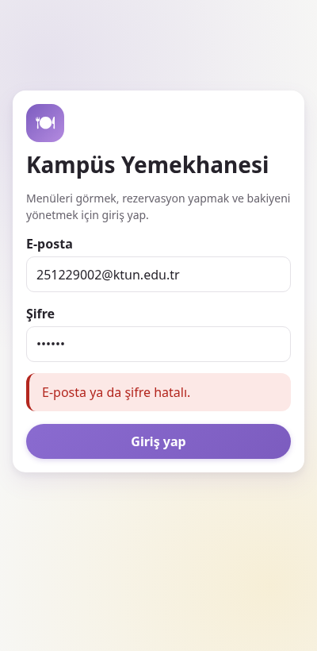
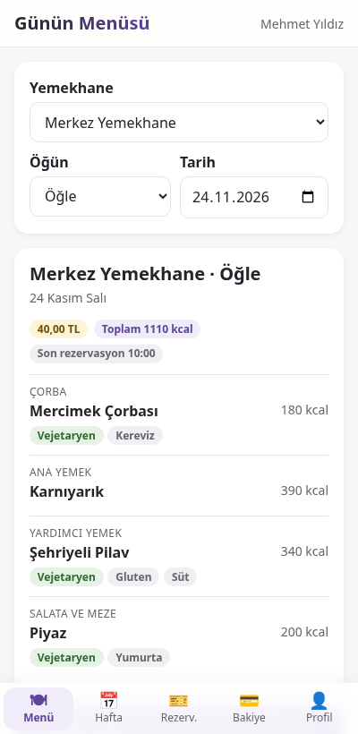
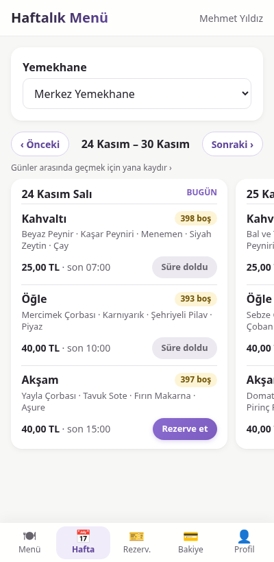
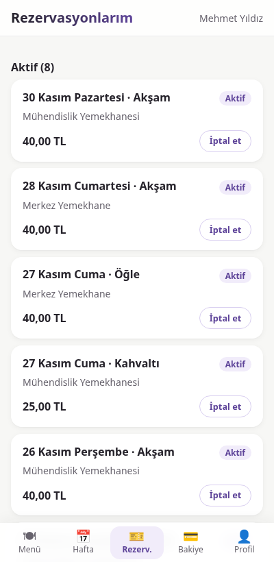
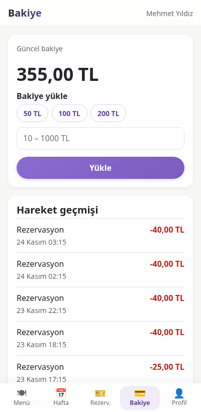
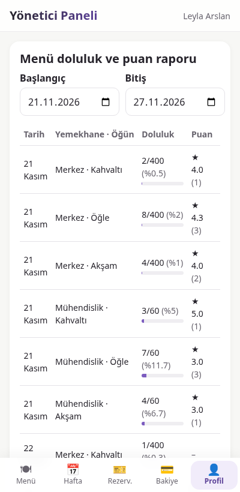
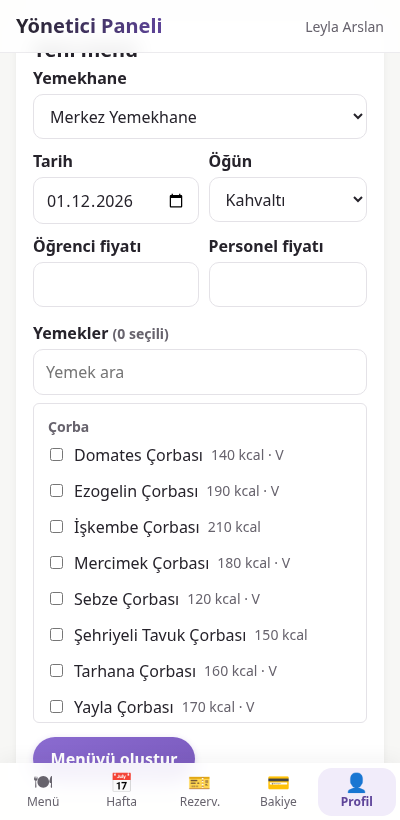
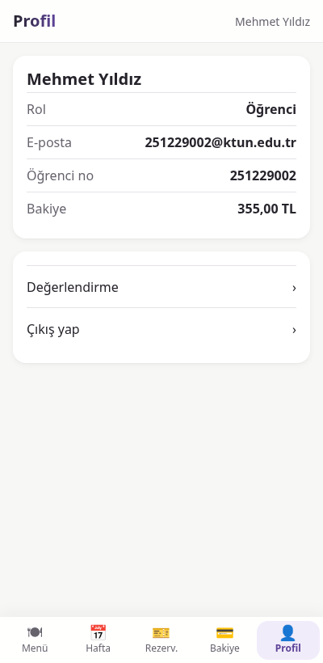
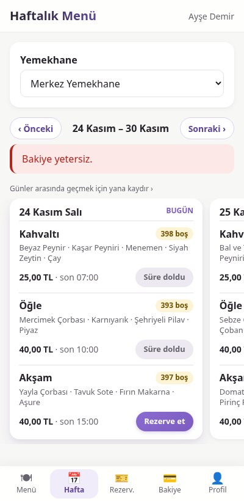
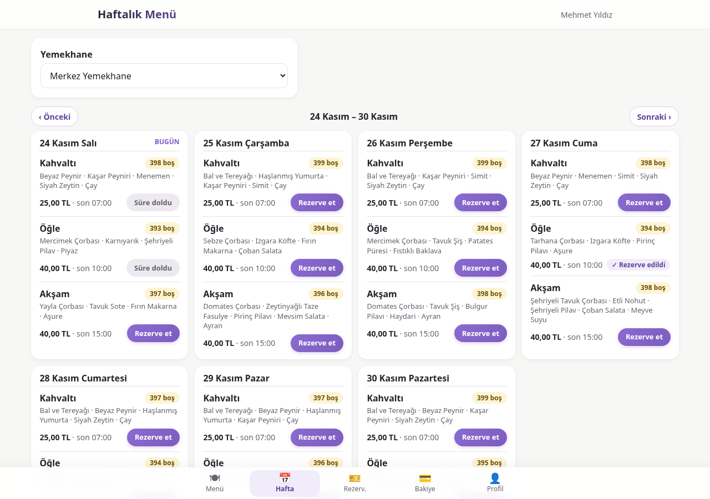

# Seçilen yol: Web API + arayüz

Uygulama **Web API** yolunda yazıldı. Sunucu tarafı Node.js üzerinde **Express** ile yazıldı
ve yalnızca JSON döndürür. Arayüz düz HTML5, CSS3 ve JavaScript'tir; `frontend` container'ındaki
Apache tarafından sunulur ve veriyi `fetch` ile `/api/...` adreslerinden alır. Apache
`-D WEBAPI` modunda çalışır ve `/api/` ile başlayan istekleri `uygulama` servisine iletir.

Depo: <https://github.com/ardaky/yemekhane-otomasyonu>

# Aşama 1 · Altyapı

Başlangıç paketi `docker compose up -d` ile çalıştırıldı. Aşağıdaki çıktıların tamamı
`rapor/kanitlar/asama-1.txt` dosyasındadır.

## Tüm servisler çalışıyor

```text
$ docker compose ps -a
NAME                        IMAGE                SERVICE         STATUS
yemekhane-frontend-1        yemekhane-frontend   frontend        Up (healthy)
yemekhane-mysql-primary-1   mysql:8.4            mysql-primary   Up (healthy)
yemekhane-mysql-replica-1   mysql:8.4            mysql-replica   Up (healthy)
yemekhane-redis-1           redis:7.4-alpine     redis           Up (healthy)
yemekhane-replica-setup-1   mysql:8.4            replica-setup   Exited (0)
```

Dört servis `healthy`. `replica-setup` bir kerelik bir iştir: replikayı kurar ve başarıyla
çıkar (`Exited (0)`). Replika zaten kuruluysa hiçbir şey yapmadan çıkar.

## Replikasyon çalışıyor

```text
$ docker compose exec -T mysql-replica mysql -uroot -pyemekhane_kok \
    -e "SHOW REPLICA STATUS\G" | grep -E "Source_Host|Running:|Seconds_Behind"
                  Source_Host: mysql-primary
           Replica_IO_Running: Yes
          Replica_SQL_Running: Yes
        Seconds_Behind_Source: 0
```

`IO` işçisi kaynağın binary log'undaki yeni değişiklikleri alır, `SQL` işçisi bunları
replikanın tablolarına uygular. İkisinin de `Yes` olması replikasyonun çalıştığını gösterir.

## Kaynakta yapılan bakiye yüklemesi replikada görünüyor

```text
$ docker compose exec -T mysql-replica mysql ... -e "SELECT id, bakiye FROM kullanicilar WHERE id = 7"
id  bakiye
7   1025.00

$ docker compose exec -T mysql-primary mysql ... -e "CALL sp_bakiye_yukle(7, 100)"
hareket_id  bakiye
461         1125.00

$ docker compose exec -T mysql-replica mysql ... -e "SELECT id, bakiye FROM kullanicilar WHERE id = 7"
id  bakiye
7   1125.00
```

Yükleme yalnızca kaynakta (`mysql-primary`) yapıldı, replika aynı değeri kendiliğinden gösterdi.

## Replikaya yazma denemesi reddediliyor

```text
$ docker compose exec -T mysql-replica mysql ... -e "CALL sp_bakiye_yukle(7, 50)"
ERROR 1290 (HY000) at line 1: The MySQL server is running with the --super-read-only
option so it cannot execute this statement
```

Replikasyon tek yönlüdür. Replikaya yazılabilseydi kaynak bu değişikliği hiç öğrenmez ve iki
veritabanı farklı bakiyeler gösterirdi. `replica-setup.sh` bu yüzden replikayı
`super_read_only` ile kilitler.

## Durdurulan replika aradaki değişikliği yakalıyor

```text
$ docker compose stop mysql-replica
$ docker compose exec -T mysql-primary mysql ... -e "CALL sp_bakiye_yukle(7, 200)"
hareket_id  bakiye
462         1325.00
$ docker compose start mysql-replica
$ docker compose exec -T mysql-replica mysql ... -e "SELECT id, bakiye FROM kullanicilar WHERE id = 7"
id  bakiye
7   1325.00
```

Replika kapalıyken kaynakta yapılan 200 TL'lik yükleme, replika açıldıktan sonra replikada da
göründü. Replika binary log'da kaldığı yeri (GTID) bildiği için açılınca kaçırdığı
değişiklikleri sırayla uygular. Verisi volume'da durduğu için container'ın durup başlaması
veriyi silmez.

## Gözlem: bilgisayar açılışında replika bir süre bağlanamayabiliyor

Bilgisayar yeniden başlatılınca iki MySQL container'ı aynı anda kalkıyor. İlk ölçümde
`Replica_IO_Running: Connecting` görüldü ve kaynakta yapılan yükleme replikaya hemen geçmedi.
Replika, kaynak henüz hazır değilken bağlanmayı denemiş ve varsayılan ayarla 60 saniye
sonra yeniden denemek üzere beklemeye geçmişti. Bağlantı kurulunca bekleyen değişikliklerin
hepsi uygulandı. Bu durum, replikanın her an kaynakla aynı olmadığını gösteren bir örnektir.

## Redis çalışıyor

```text
$ docker compose exec -T redis redis-cli ping
PONG
```

# Aşama 2 · Uygulama

## Mimari ve katmanlar

Uygulama `uygulama/` klasöründedir ve compose dosyasına `uygulama` servisi olarak eklenmiştir.
Container içinde 8000 portunu dinler, dışarıya port açmaz: tarayıcı uygulamaya yalnızca Apache
üzerinden (`/api/...`) ulaşır. Veritabanı ve Redis adreslerini compose dosyasındaki ortam
değişkenlerinden (`DB_YAZMA_HOST`, `DB_OKUMA_HOST`, ...) okur.

| Katman | Dosyalar | Görevi |
|---|---|---|
| Rotalar | `src/rotalar.js` | Hangi adres ve yöntemin hangi controller fonksiyonuna gideceği |
| Controller | `src/controllers/*.js` | Girdiyi denetler, iş kurallarını uygular, JSON yanıtı kurar. SQL içermez |
| Veri katmanı | `src/veri/*.js` | Bütün SQL buradadır. `yazma` (kaynak) ve `okuma` (replika) havuzları |
| Oturum | `src/oturum/*.js` | Giriş yapan kullanıcıyı token ile tanır, rol kontrolü yapar |
| Arayüz | `frontend/*.html`, `frontend/js/*.js` | HTML5 + CSS3, veriyi `fetch` ile alır. İş kuralı içermez |

Para hareketi yapan işlemlerde SQL yeniden yazılmadı, hazır stored procedure'ler çağrıldı:
rezervasyon (`sp_rezervasyon_yap`), iptal (`sp_rezervasyon_iptal`) ve bakiye yükleme
(`sp_bakiye_yukle`). Menü ekranları `v_menu_detay` ve `v_menu_doluluk`, yönetici raporu
ayrıca `v_menu_puan` view'larını kullanır.

## Bir isteğin yolu: rezervasyon yapmak

Kullanıcı haftalık menüde "Rezerve et" düğmesine bastığında arayüz şu isteği gönderir:

```js
// frontend/js/haftalik.js
const sonuc = await api('/rezervasyonlar', { yontem: 'POST', govde: { menuId } });
```

Apache `/api/` ile başlayan isteği `uygulama:8000`'e iletir. Express'te istek önce oturum
kontrolünden geçer (`girisGerekli`, çerezdeki token'dan kullanıcıyı bulur), sonra rotaya göre
controller'a gider:

```js
// src/rotalar.js
rota.use(girisGerekli);
rota.post('/rezervasyonlar', rezervasyon.yap);
```

Controller girdiyi denetler ve veri katmanını çağırır. SQL yazmaz:

```js
// src/controllers/rezervasyonController.js
async function yap(req, res) {
  const menuId = tamSayi(req.body && req.body.menuId, 'menü');
  const sonuc = await rezervasyonVerisi.yap(req.kullanici.kullaniciId, menuId);
  res.status(201).json({ rezervasyonId: sonuc.rezervasyon_id, ucret: sonuc.ucret, bakiye: sonuc.bakiye });
}
```

Veri katmanı stored procedure'ü **kaynak** bağlantısı üzerinden çağırır:

```js
// src/veri/rezervasyonVerisi.js
function yap(kullaniciId, menuId) {
  return yordam('sp_rezervasyon_yap', [kullaniciId, menuId]);
}

// src/veri/baglanti.js
async function yordam(ad, parametreler) {
  const yer = parametreler.map(() => '?').join(', ');
  const [sonuc] = await yazma.query(`CALL ${ad}(${yer})`, parametreler);
  return sonuc[0][0];
}
```

Yanıt `{"rezervasyonId":368,"ucret":40,"bakiye":315}` biçiminde JSON olarak döner ve arayüz
"Rezervasyon yapıldı. 40,00 TL düşüldü, güncel bakiyen 315,00 TL." mesajını gösterir.

Yordam hata verirse (ör. bakiye yetmiyorsa) MySQL `SQLSTATE 45000` ve Türkçe mesaj döndürür.
`src/hatalar.js` bu hatayı yakalar ve mesajı değiştirmeden `{"hata":"Bakiye yetersiz."}` olarak
iletir; arayüz de onu kırmızı bildirim kutusunda gösterir. Diğer veritabanı hataları (CHECK ihlali
gibi) günlüğe yazılır, kullanıcıya ham hali gösterilmez.

## Okuma ve yazma ayrımı

| İşlem | Bağlantı |
|---|---|
| Rezervasyon, iptal, bakiye yükleme (stored procedure) | Kaynak (`mysql-primary`) |
| Değerlendirme ekleme, menü oluşturma ve düzenleme | Kaynak |
| Giriş sırasında kullanıcıyı bulma | Kaynak (yeni açılmış hesap replikada henüz olmayabilir) |
| Değerlendirmeden hemen önce "bu menü kullanıldı mı?" kontrolü | Kaynak (yazmayla tutarlı olsun) |
| Günün menüsü, haftalık menü, rezervasyonlarım, bakiye geçmişi | Replika (`mysql-replica`) |
| Değerlendirme listeleri, yönetici raporu | Replika |

## Rezervasyondan sonraki bakiye neden kaynaktan okunuyor

MySQL replikasyonu eşzamansızdır. Kaynak bir değişikliği kendi tablosuna ve binary log'a yazar
ve uygulamaya hemen "tamam" der; replikanın bu değişikliği binary log'dan alıp uygulaması bir
süre sonra olur. Bu süre normalde milisaniyelerdir ama sistem yoğunken saniyelere çıkabilir
(Aşama 1'de, açılışta replikanın bir süre bağlanamadığı durumda bu açıkça görüldü). Rezervasyondan
hemen sonra bakiye replikadan okunsaydı, replika rezervasyonu henüz almamış olabileceği için
kullanıcı eski bakiyesini görür ve paranın düşmediğini sanabilirdi. Bu yüzden rezervasyon, iptal
ve yüklemeden sonra gösterilen bakiye, kaynakta çalışan yordamın döndürdüğü değerdir. Aynı
nedenle haftalık menü rezervasyondan sonra replikadan yeniden çekilmez; arayüz o menüyü yerinde
"Rezerve edildi" olarak işaretler ve boş yer sayısını bir azaltır.

## Ekranlar (telefon genişliği, 400 px)

Arayüz mobil önce tasarlandı. Telefonda ekranlar arasında alt sekme çubuğuyla geçilir; haftalık
menüde her gün bir karttır ve günler arasında yana kaydırılır. Geniş ekranda gün kartları ızgara
olarak dizilir.

{width=32%} {width=32%} {width=32%}

{width=32%} {width=32%} {width=32%}

{width=32%} {width=32%} {width=32%}

Sırasıyla: giriş (hatalı şifre mesajı), günün menüsü (toplam kalori, vejetaryen ve alerjen
etiketleri), haftalık menü (boş yer, rol fiyatı, süresi geçen öğünde pasif düğme),
rezervasyonlarım (aktif kayıtta iptal), bakiye (yükleme ve hareket geçmişi), değerlendirme
(kullanılmış menüye 1–5 puan), yönetici paneli (menü bazında doluluk ve ortalama puan; menü
oluşturma ve düzenleme) ve profil.

## Hata mesajının arayüze taşınması

{width=32%}

Bakiyesi 12,50 TL olan öğrenci 40 TL'lik bir menüye rezervasyon yapmak istediğinde
`sp_rezervasyon_yap` yordamının döndürdüğü "Bakiye yetersiz." mesajı değiştirilmeden gösterilir.

## Geniş ekran

{width=90%}
